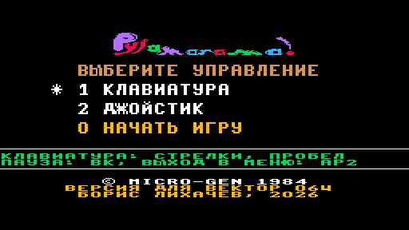
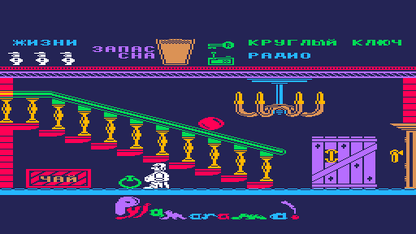
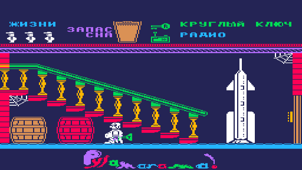
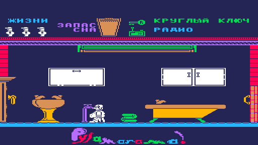

# Pyjamarama — порт на Вектор-06Ц

**Pyjamarama** (Mikro-Gen, 1984, ZX Spectrum 48K) на ванильном **Векторе-06Ц**: i8080 3 МГц, 64 КБ,
без Z80-переходника и без квазидиска. Версия **0.5a (альфа)**. Код игры — ZX-версия V1 по
дизассемблированию luny.co.uk, переведённая на i8080 через JS-модель; игровая логика сверена с оригиналом
ZX шаг в шаг. Вывод, звук, ввод, меню и заставка — свои, под Вектор: 8 цветов вместо атрибутов ZX,
звук на ВИ53.

| Заставка | Меню |
|---|---|
|  |  |

| Игра | Ракета | Ванная |
|---|---|---|
|  |  |  |

## Готовые образы

Образ памяти **с адреса 0x0000** (формат `.C00` / `.r0m`): на MiSTer (ядро Vector-06C) открывается
через меню ядра как `.C00`, в эмуляторах — как `.r0m`.

| Файл | Что это |
|---|---|
| [`rom/pyjamarama.c00`](rom/pyjamarama.c00) | для MiSTer: заставка, меню, игра (русская версия) |
| [`rom/pyjamarama.r0m`](rom/pyjamarama.r0m) | тот же образ для эмуляторов (Emu80, vector06js) |

В альфе — только русская версия. Английская сборка (оригинальные тексты) пока служит эталоном для
стендов: в ней не сдвинут блок энергии и выключена перекраска мебели.

## Управление

На заставке — любая клавиша. В меню: **1** — клавиатура, **2** — джойстик «П» (одно из двух),
**0** — начать игру. Для неуязвимости вместо «0» нажать **F1+F3**.

| действие | клавиши |
|---|---|
| влево, вправо | стрелки (джойстик «П»: наклон) |
| прыжок | пробел или ↑ (джойстик «П»: огонь) |
| пауза | ВК |
| в меню | АР2 |

Как и в ZX-оригинале, **в дверь входят прыжком**: подойти и прыгнуть. Дверь слева на кухне (комната 4)
открывается только с дверной ручкой в кармане; три двери в шахту лифта (слева в комнатах 15, 16 и 22) —
только когда лифт включён кнопкой в кухне.

## Что по-другому, чем на ZX

- **Цвет без клэша.** Каждый объект рисуется в своих плоскостях Вектора, цвет попиксельный; фон тёмно-синий
  (в игре) и чёрный (в меню). Палитра задумана по мотивам ремейка MinionSoft для PICO-8 (2023).
  Часть предметов перекрашена: ракета, шкафы в ванной, паутина — белые, сундуки — оранжевые, цветы
  в кашпо — зелёные (таблица `rm_tab` в `src/vec/room.asm`).
- **Заставка** — экран ZX, раскрашенный нейросетью по контуру и подогнанный под палитру Вектора, на весь
  экран 256×256; чёрный бордюр, плавное появление за счёт яркости палитры. Хранится сжатой (ZX0)
  в плоскостях экрана и распаковывается на чёрном экране.
- **Меню** — выбор управления цифрами, как в ZX; в верхней полосе экрана, над игровым полем; логотип
  рисуется один раз и остаётся на весь запуск, меню сдвигается аппаратным скроллингом.
- **Музыка меню** — «Popcorn» (Gershon Kingsley) в ASC-версии Andrew Sendetski, на двух каналах ВИ53
  (мелодия и бас), играет два раза и затихает. Ударных нет: свободных каналов не осталось.
- **Звук** — эффекты оригинала, пересчитанные с бипера ZX на ВИ53; игра их не ждёт.
- **Русские тексты**: название предметов (13 знаков в строке), «пустая канистра» и т. п. вместо FULL/EMPTY.

Известные ограничения альфы: Уолли одноцветный (двухцветную раскраску отложил из-за скорости), бас и
ударные Popcorn не воспроизводятся полностью, английской версии для игры нет, на железе MiSTer образ
запускался, но полностью не проходился.

## Сборка

Нужны Python 3 (Pillow), Node.js, [sjasmplus](https://github.com/z00m128/sjasmplus) (в PATH или
переменная `SJASMPLUS`) и `tools/zx0/zx0` (`clang -O2 -o tools/zx0/zx0 tools/zx0/*.c`).

Материалы оригинала в репозиторий **не входят** (лента, снимок памяти ZX, ПЗУ 48K, зеркало дизассемблирования
luny.co.uk, кадры ремейка). Для пересборки нужны `ref/pyjamarama.lst`, `ref/48.rom` и `build/v1/ram.bin`
(снимок памяти после распаковки загрузчика редакции V1: `tools/unpack.js`, `tools/unpack_tzx.js`).

```sh
PJ_LANG=ru sh tools/rebuild.sh        # данные, заставка, логотип, меню, музыка, ассемблирование -> build/vec/pyjama.r0m
```

## Проверки

Стенды — на Node.js; ядро i8080 и эмулятор Вектора — [vector06js](https://github.com/svofski/vector06js)
(клон в `~/projects/vector06js` или путь в `V06JS`). Стенды сверяют с ZX английскую сборку
(`PJ_LANG=en sh tools/rebuild.sh`).

```sh
node tools/gfxcheck.js 200 1          # графика Вектора против примитивов ZX
node tools/lockn.js                   # Уолли: рисование и стирание
node tools/lockn_inv_loop.js          # аркада с захватчиками
node tools/sndcheck.js                # звук
node tools/vecshot.js build/vec/pyjama.r0m 300 "" out.png      # снимок экрана без окна
node tools/allrooms.js build/rooms    # снимки всех комнат
tools/emu80_run.sh                    # запуск в Emu80 с окном
```

Ход работы — [docs/JOURNAL.md](docs/JOURNAL.md), цвета — [docs/COLOR.md](docs/COLOR.md).

## Откуда

Оригинал — Mikro-Gen, 1984. Дизассемблирование ZX — luny.co.uk/pyjamarama (SkoolKit, Ричард Даймонд).
Палитра и оформление меню — по мотивам ремейка MinionSoft (PICO-8, 2023). Музыка — «Popcorn»,
Gershon Kingsley; ASC-версия — Andrew Sendetski. Сжатие — ZX0 Эйнара Саукаса, распаковщик i8080 —
Иван Городецкий (ivagor). Z80.js — Molly Howell (MIT). Порт на Вектор-06Ц — Борис Лихачёв, 2026.
